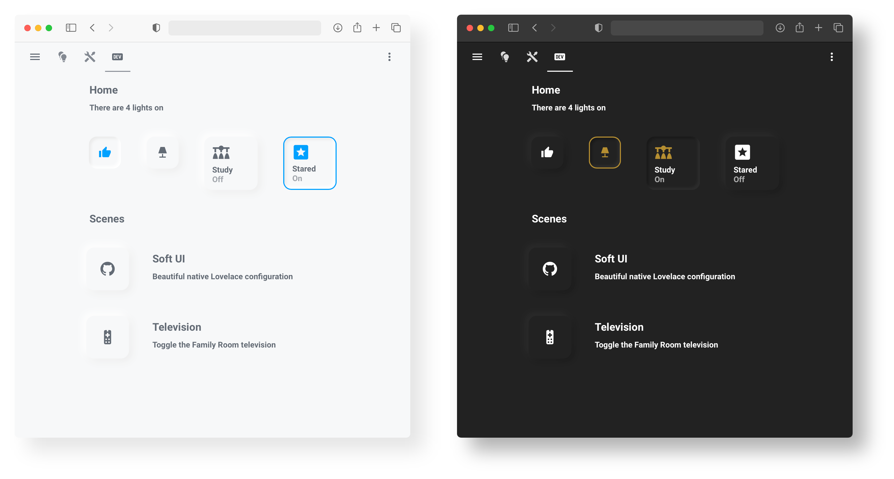
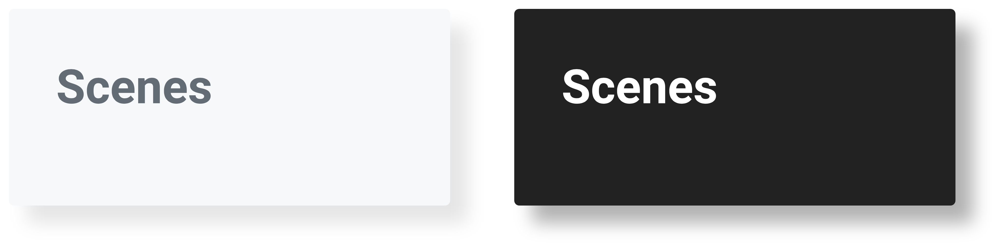
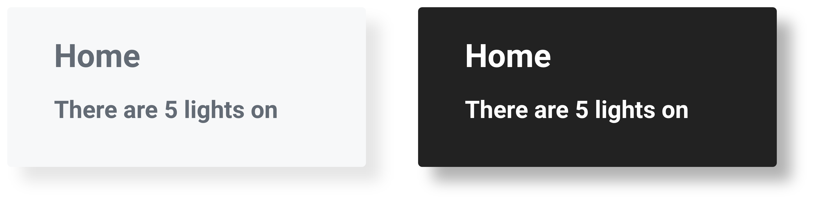
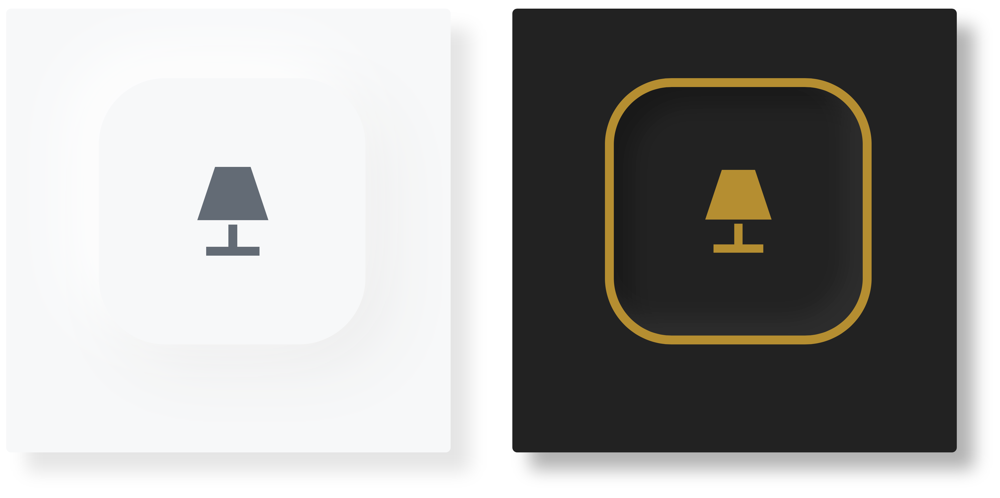
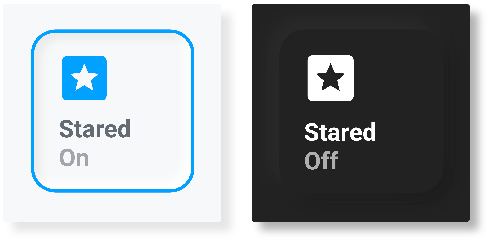
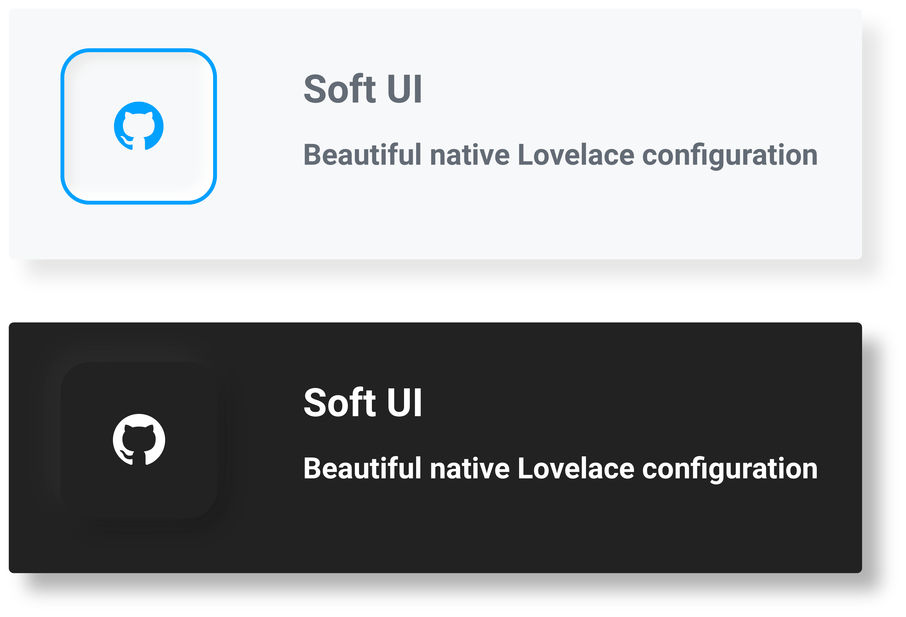

# Lovelace Soft UI
> **Note:** This project is archived and no longer maintained.
> It remains available as a reference for anyone exploring neumorphic UI in Home Assistant.
> See the [community forum thread](https://community.home-assistant.io/t/lovelace-soft-ui-simple-and-clean-lovelace-configuration) for discussion and examples from other users.
>
> Thank you to everyone who used, contributed, or shared feedback on this project ❤️



A neumorphic theme for [Home Assistant](https://www.home-assistant.io) Lovelace.
Elegant soft shadows, light & dark modes, and a set of reusable card components.

## Installation

Requires [card-mod](https://github.com/thomasloven/lovelace-card-mod) (install via [HACS](https://hacs.xyz)).
Add the soft UI styles to your theme YAML (`config/themes/{theme_name}/{theme_name}.yaml`) using one of two methods:

<details>
<summary><b>Universal</b> — styles all cards</summary>

```yaml
# Light
theme_name:
  card-mod-theme: theme_name
  card-mod-card: |
    ha-card {
      margin: 20px;
      border-radius: 15px;
      background-color: var(--primary-background-color);
      box-shadow: -5px -5px 15px #ffffff, 5px 5px 15px #ebebeb;
    }
  soft-ui-pressed: 'inset -4px -4px 5px #ffffff, inset 4px 4px 5px #ebebeb'
```

```yaml
# Dark
theme_name:
  card-mod-theme: theme_name
  card-mod-card: |
    ha-card {
      margin: 20px;
      border-radius: 15px;
      background-color: var(--primary-background-color);
      box-shadow: -5px -5px 15px #2c2c2c, 5px 5px 15px #191919;
    }
  soft-ui-pressed: 'inset -4px -4px 5px #2c2c2c, inset 4px 4px 5px #191919'
```

</details>

<details>
<summary><b>Individual</b> — styles only cards with the <code>soft-ui</code> class</summary>

```yaml
# Light
theme_name:
  card-mod-theme: theme_name
  card-mod-card: |
    ha-card.soft-ui {
      margin: 20px;
      border-radius: 15px;
      background-color: var(--primary-background-color);
      box-shadow: -5px -5px 15px #ffffff, 5px 5px 15px #ebebeb;
    }
  soft-ui-pressed: 'inset -4px -4px 5px #ffffff, inset 4px 4px 5px #ebebeb'
```

```yaml
# Dark
theme_name:
  card-mod-theme: theme_name
  card-mod-card: |
    ha-card.soft-ui {
      margin: 20px;
      border-radius: 15px;
      background-color: var(--primary-background-color);
      box-shadow: -5px -5px 15px #2c2c2c, 5px 5px 15px #191919;
    }
  soft-ui-pressed: 'inset -4px -4px 5px #2c2c2c, inset 4px 4px 5px #191919'
```

Then reference the class in any card:

```yaml
card_mod:
  class: soft-ui
```

</details>

## Cards

Button cards require [button-card](https://github.com/custom-cards/button-card).
Add cards via the Manual card option in the Lovelace UI.

**Heading** ([heading.yaml](cards/text/heading.yaml))



**Heading & Subheading** ([heading_subheading.yaml](cards/text/heading_subheading.yaml))



**Button** ([button.yaml](cards/button/button.yaml))


**Button Border** ([button_border.yaml](cards/button/button_border.yaml))



**Button Text** ([button_text.yaml](cards/button/button_text.yaml))


**Button Border Text** ([button_border_text.yaml](cards/button/button_border_text.yaml))



**Button Description** ([button_description.yaml](cards/button/button_description.yaml))


